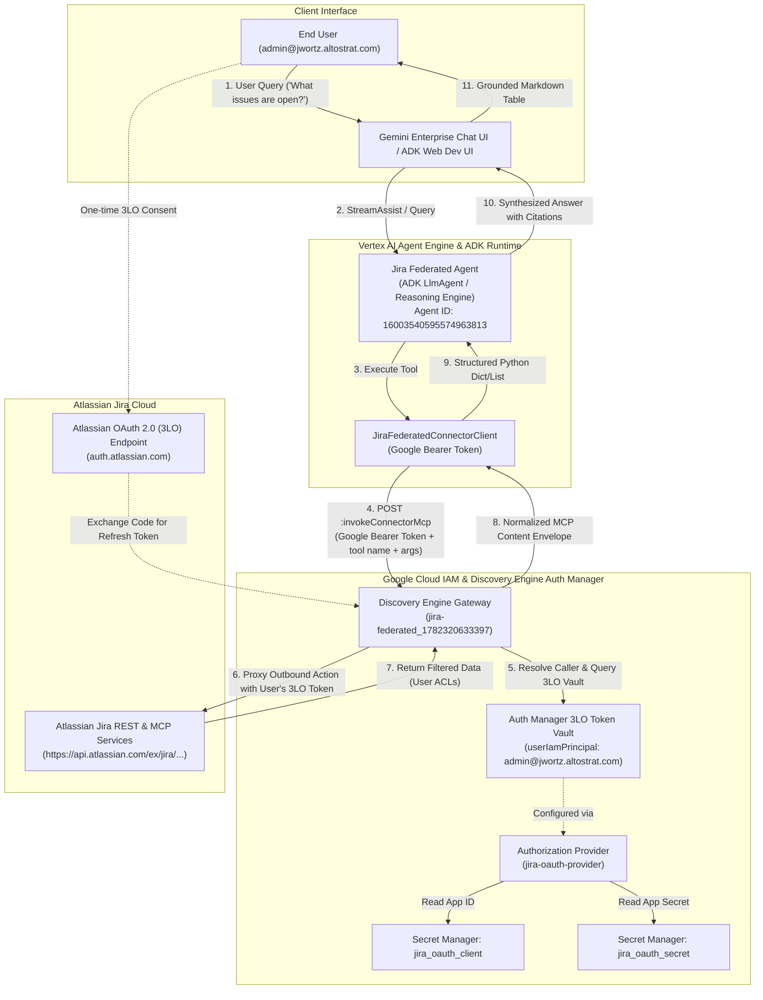
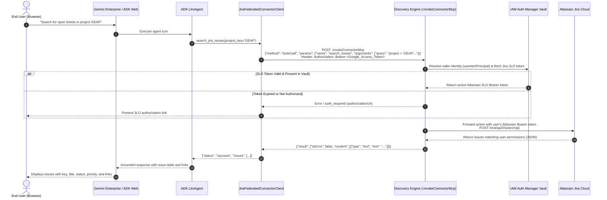
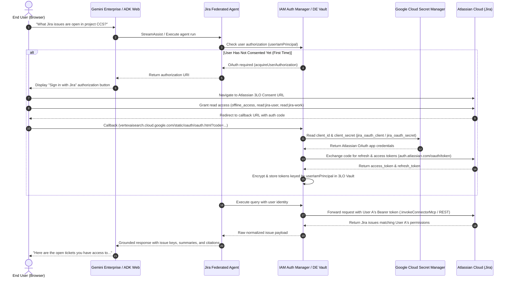

# Gemini Enterprise Jira Federated Connector — ADK RAG Agent (`gemini-jira-federated`)

This repository demonstrates how to build a grounded **Google Agent Development Kit (ADK)** agent over a **Gemini Enterprise (Discovery Engine) Federated Jira Data Connector** (`connectorType: "THIRD_PARTY_FEDERATED"`) using **end-user OAuth2 authentication (3-Legged OAuth / 3LO)** backed by **Google Cloud IAM Auth Manager** and **Google Cloud Secret Manager**.


---

## Architecture & End-User 3LO Auth Manager Integration

When generative AI agents interact with third-party SaaS systems like Jira, they must authenticate outbound requests securely. Rather than using static service account API tokens (which would expose all corporate Jira tickets to all users), this architecture implements **delegated user identity (3-Legged OAuth / 3LO)** via the **Google Cloud IAM Auth Manager** and Discovery Engine Authorization Services.

> [!NOTE]
> For official Google Cloud architectural principles on agent credential brokering, see the [Google Cloud IAM Auth Manager Overview](https://docs.cloud.google.com/iam/docs/auth-manager-overview), [Agent Identity Auth Manager Overview](https://cloud.google.com/iam/docs/agent-identity-auth-manager-overview), and [Authenticate using 3-legged OAuth with auth manager](https://cloud.google.com/iam/docs/agent-identity-auth-manager-oauth3).

### Component Architecture



---

### Sequence Flow: Direct Federated MCP Invocation (`invokeConnectorMcp`)



---

### End-to-End 3-Legged OAuth Sequence Flow



---

## How End-User Credentials & Data Isolation Work

### 1. Zero Shared Master Credentials
In standard API-key architectures, an application shares a single service account token across all queries. If an agent executes a query on behalf of User A, the service account could inadvertently expose issues from confidential projects that User A has no permission to view in Jira.

### 2. IAM Principal Keying (`userIamPrincipal`)
Google Cloud's Auth Manager binds each Atlassian OAuth refresh token directly to the calling Google Cloud IAM Principal (e.g. `userIamPrincipal: admin@jwortz.altostrat.com`).
- **User A** only retrieves tickets visible to User A in Atlassian Jira.
- **User B** only retrieves tickets visible to User B in Atlassian Jira.
- Atlassian's native Issue Security Schemes, Project Permissions, and Role-Based Access Controls (RBAC) are fully preserved.

### 3. Secret Manager Security (Pattern 2)
The OAuth App Client ID and Client Secret are stored in Google Cloud Secret Manager:
- `projects/679926387543/secrets/jira_oauth_client`
- `projects/679926387543/secrets/jira_oauth_secret`

Access is restricted via IAM to the Discovery Engine service agent (`service-679926387543@gcp-sa-discoveryengine.iam.gserviceaccount.com`) and Compute Engine SA (`roles/secretmanager.secretAccessor`). No secrets are ever stored in plain text or Git.

---

## Troubleshooting & The Atlassian 3LO Error Fix

### The Problem
When clicking the Jira sign-in link, users previously encountered:
```text
Hmm... We're having trouble logging you in.
The authorize request was incomplete or invalid. Start again from the app to initiate sign-in and ensure the link includes all required details. Contact the app developer for further help.
error: invalid_request
error_description: Incorrect request parameters
00177fd7-175a-11fb-46de-94e89f6fd34b
```

### The Root Cause
1. **Missing `response_type=code`**: RFC 6749 and Atlassian 3LO strictly require `response_type=code`. Discovery Engine's internal authorization URL builder does **not** automatically inject `response_type`; it expects it within the `authorizationUri` template.
2. **Missing `redirect_uri`**: Atlassian requires `redirect_uri=https%3A%2F%2Fvertexaisearch.cloud.google.com%2Fstatic%2Foauth%2Foauth.html` matching the callback URL configured in the Atlassian Developer Console.
3. **Scope Family Mismatch**: Atlassian separates scopes into **Classic** (`offline_access`, `read:jira-user`, `read:jira-work`) and **Granular** (`read:issue:jira`). Requesting a granular scope on an app configured with classic scopes causes Atlassian to reject the authorize request as `invalid_request`.

### The Fix
In `scripts/setup_jira_auth_provider.py`, the `authorizationUri` is configured as:
```text
https://auth.atlassian.com/authorize?audience=api.atlassian.com&redirect_uri=https%3A%2F%2Fvertexaisearch.cloud.google.com%2Fstatic%2Foauth%2Foauth.html&response_type=code&prompt=consent
```
With classic scopes:
```python
DEFAULT_SCOPES = [
    "offline_access",
    "read:jira-user",
    "read:jira-work",
]
```

When Discovery Engine executes `acquireUserAuthorization`, it produces the complete, RFC-compliant 3LO URL:
```text
https://auth.atlassian.com/authorize?audience=api.atlassian.com&redirect_uri=https%3A%2F%2Fvertexaisearch.cloud.google.com%2Fstatic%2Foauth%2Foauth.html&response_type=code&prompt=consent&client_id=RyA0UoXKSMmuQqEDMSLnOZQCzM0Eadic&scope=offline_access+read:jira-user+read:jira-work&state=...
```

---

## Target Data Source (Configured via `.env`)
Configure your target Discovery Engine app and Jira connector in `.env` (see [`.env.example`](.env.example)):
- **GCP Project**: `DISCOVERY_ENGINE_PROJECT_ID` (`DISCOVERY_ENGINE_PROJECT_NUMBER`)
- **Discovery Engine App / Engine**: `DISCOVERY_ENGINE_ID` (`grocery-workshop-engine`, `global`)
- **Data Connector Collection**: `JIRA_CONNECTOR_COLLECTION_ID` (e.g. `jira-federated_...` or `jira_1759440079662`)
- **Entity Data Stores (10)**:
  - `_issue`, `_bug`, `_epic`, `_story`, `_task`, `_comment`, `_attachment`, `_project`, `_worklog`, `_board`
- **Atlassian Jira Cloud Instance**: `JIRA_INSTANCE_URI` (e.g. `https://<tenant>.atlassian.net`)

---

## Retrieval Modes (`JIRA_RETRIEVAL_MODE`)

This agent supports two complementary retrieval strategies over the federated connector:

| Retrieval Mode | Primary API Endpoint | Strengths & Characteristics | Best For |
| :--- | :--- | :--- | :--- |
| **`mcp`** *(Default / Option A)* | `dataConnector:invokeConnectorMcp` | **Native Model Context Protocol (MCP)**: Directly executes Jira tools (`search_issues`, `get_issue`, `list_projects`, `create_comment`, `create_issue`, `list_comments`) through Discovery Engine. Discovery Engine checks Auth Manager for the user's 3LO token, executes the action, and returns normalized JSON. | Granular searches, issue inspection, comment management, issue filing, interactive tools. |
| **`stream_assist`** | `assistants/default_assistant:streamAssist` | **Native Gemini Enterprise Assistant**: Queries across all 10 per-entity data stores simultaneously; returns native `groundingChunks` citations and synthesized answers directly from Google's AssistantService. | High-level synthesis, cross-entity summaries, direct grounding citation benchmarks. |

Configure in `.env`:
```bash
# Options: 'mcp' (default) or 'stream_assist'
JIRA_RETRIEVAL_MODE=mcp
```

---

## Option A: Direct Federated MCP Tool (`dataConnector:invokeConnectorMcp`)

Discovery Engine federated connectors (`jira-federated_1782320633397`) natively expose Model Context Protocol (MCP) actions over a single Google Cloud REST/gRPC endpoint:

```http
POST https://discoveryengine.googleapis.com/v1alpha/projects/{project}/locations/{location}/collections/{collection}/dataConnector:invokeConnectorMcp
Authorization: Bearer <GOOGLE_ACCESS_TOKEN>
x-goog-user-project: <PROJECT_ID>
Content-Type: application/json
```

### Request Flow
1. **Google Authentication**: The agent invokes `dataConnector:invokeConnectorMcp` with the user's Google Cloud access token (or Vertex AI Agent Engine identity).
2. **Auth Manager Lookup**: Discovery Engine identifies the caller and queries the **Google Cloud IAM Auth Manager** token vault for that user's linked Atlassian Jira 3LO OAuth token.
3. **Secure Forwarding**: Discovery Engine dispatches the native MCP tool call to Atlassian Jira Cloud (`https://api.atlassian.com/ex/jira/{cloudId}/...`) with the user's Jira Bearer token.
4. **Normalized Response**: Discovery Engine returns the normalized JSON payload inside an MCP content envelope (`{"result": {"isError": false, "content": [{"type": "text", "text": "..."}]}}`).

### Supported MCP Tools

| MCP Tool Name | ADK Agent Tool Wrapper | Description & Arguments |
| :--- | :--- | :--- |
| **`search_issues`** | `search_jira_issues` | Searches issues with JQL (`query`, `maxResults`, `sort_by`, `expanded_view`). Enforces bounded queries to prevent Jira 400 errors. |
| **`get_issue`** | `get_jira_issue` | Fetches full issue details by key (`Id: "GEAP-3"`), including status, priority, reporter, assignee, attachments, and sub-tasks. |
| **`list_projects`** | `list_jira_projects` | Lists all Jira projects accessible to the user (`page_size`, `page_token`). |
| **`create_comment`** | `create_jira_comment` | Posts a new comment to a Jira issue (`IssueKey`, `Body`). |
| **`update_comment`** | *(client method)* | Updates an existing comment on an issue (`IssueKey`, `Id`, `Body`). |
| **`list_comments`** | `list_jira_comments` | Lists comment threads on an issue (`IssueKey`, `page_size`). |
| **`create_issue`** | `create_jira_issue` | Files a new ticket in Jira Cloud (`ProjectKey`, `Summary`, `IssueTypeId`, `Description`, `PriorityName`). |
| **`upload_attachment`** | *(client method)* | Attaches a file to a ticket (`IssueKey`, `InputFileName`, `Content`). |
| **`list_tools`** | *(client method)* | Queries Discovery Engine with `method: "tools/list"` to inspect the 32 exposed connector tools. |

---

## How We Used Google Cloud IAM Auth Manager & Direct Federated MCP

### 1. Pattern 2 Authorization Setup
We configured Discovery Engine's Authorization Provider (`projects/679926387543/locations/global/authorizations/jira-oauth-provider`) to reference OAuth App credentials stored securely in Google Cloud Secret Manager:
- **Client ID Secret**: `projects/679926387543/secrets/jira_oauth_client`
- **Client Secret**: `projects/679926387543/secrets/jira_oauth_secret`
- **Atlassian 3LO Authorization URI**:
  ```text
  https://auth.atlassian.com/authorize?audience=api.atlassian.com&redirect_uri=https%3A%2F%2Fvertexaisearch.cloud.google.com%2Foauth-redirect&response_type=code&prompt=consent
  ```
- **Atlassian Token URI**: `https://auth.atlassian.com/oauth/token`
- **OAuth Scopes**: `offline_access`, `read:jira-user`, `read:jira-work`

### 2. User Authorization Vault Handshake
When an end-user first interacts with the agent or clicks the sign-in link:
1. The user authenticates with Atlassian Jira Cloud and approves delegated access.
2. Atlassian redirects with an authorization code to `https://vertexaisearch.cloud.google.com/oauth-redirect?code=...`.
3. Discovery Engine exchanges the authorization code for a Jira refresh token using the Secret Manager credentials.
4. The refresh token is encrypted and stored in Discovery Engine's Auth Manager vault, securely indexed by the user's Google Cloud IAM Principal (`userIamPrincipal: <user_email>`).

### 3. Direct MCP Dispatch via `invokeConnectorMcp`
When an agent tool executes:
1. The agent client [`JiraFederatedConnectorClient`](jira_federated_agent/jira_connector_client.py) prepares an MCP JSON-RPC payload:
   ```python
   payload = {
       "method": "tools/call",
       "params": {
           "name": "search_issues",
           "arguments": {
               "query": "created is not null order by created desc",
               "maxResults": 20,
           },
       },
       "engine": "projects/679926387543/locations/global/collections/default_collection/engines/grocery-workshop-engine",
   }
   ```
2. The agent issues a `POST` request to `https://discoveryengine.googleapis.com/v1alpha/projects/679926387543/locations/global/collections/jira-federated_1782320633397/dataConnector:invokeConnectorMcp` authenticated with the caller's Google access token (`Authorization: Bearer ya29...`).
3. Discovery Engine verifies caller permissions (`discoveryengine.dataConnectors.executeAction`), resolves the caller's identity, retrieves that specific user's Atlassian 3LO access token from the Auth Manager vault, forwards the request to Jira Cloud, and returns the response in standard MCP format:
   ```json
   {
     "result": {
       "isError": false,
       "content": [
         {
           "type": "text",
           "text": "{\"result\":{\"results\":[{\"key\":\"GEAP-3\",\"title\":\"VPC-SC connector test\"...}]}}"
         }
       ]
     }
   }
   ```
4. The client unwraps the MCP content envelope and extracts the structured JSON, returning clean dictionaries to the ADK agent.

---

## Required Google Cloud APIs & IAM Roles

### 1. Required Google Cloud APIs
To operate this architecture, the following Google Cloud APIs must be enabled in your GCP project:

| API Service Name | Service Endpoint | Purpose |
| :--- | :--- | :--- |
| **Discovery Engine API** | `discoveryengine.googleapis.com` | Gemini Enterprise engines, federated data connectors, Auth Manager authorizations, and `:invokeConnectorMcp` endpoint. |
| **Vertex AI API** | `aiplatform.googleapis.com` | Vertex AI Gemini models, Reasoning Engines, Agent Engine, and ADK agent hosting. |
| **Secret Manager API** | `secretmanager.googleapis.com` | Secure storage of OAuth App Client ID and Client Secret (Pattern 2). |
| **IAM API** | `iam.googleapis.com` | Service account management, IAM policy bindings, and identity federation. |
| **IAM Credentials API** | `iamcredentials.googleapis.com` | Short-lived OAuth2 access token generation and service account impersonation. |
| **Service Usage API** | `serviceusage.googleapis.com` | Service enablement and quota management. |
| **Cloud Resource Manager API** | `cloudresourcemanager.googleapis.com` | Project-level IAM policy queries and resource management. |

Enable all required APIs with a single `gcloud` command:
```bash
gcloud services enable \
  discoveryengine.googleapis.com \
  aiplatform.googleapis.com \
  secretmanager.googleapis.com \
  iam.googleapis.com \
  iamcredentials.googleapis.com \
  serviceusage.googleapis.com \
  cloudresourcemanager.googleapis.com \
  --project="wortz-project-352116"
```

### 2. External Third-Party APIs
- **Atlassian OAuth 2.0 (3LO) Endpoint**: `https://auth.atlassian.com` (`/authorize`, `/oauth/token`)
- **Atlassian Cloud REST API**: `https://api.atlassian.com` (`/oauth/token/accessible-resources`, `/ex/jira/{cloudId}/rest/api/3/...`)

### 3. Required IAM Roles & Permissions

| Identity | Required IAM Role | Purpose |
| :--- | :--- | :--- |
| **Calling User** (`admin@jwortz.altostrat.com`) | `roles/discoveryengine.admin` | Access Gemini Enterprise search apps and execute data connector actions (`discoveryengine.dataConnectors.executeAction`). |
| | `roles/aiplatform.user` | Query Vertex AI reasoning engines and Gemini models. |
| | `roles/secretmanager.viewer` | Verify OAuth secret metadata. |
| **Discovery Engine Service Agent** (`service-<PROJECT_NUM>@gcp-sa-discoveryengine.iam.gserviceaccount.com`) | `roles/secretmanager.secretAccessor` | Read `jira_oauth_client` and `jira_oauth_secret` from Secret Manager during OAuth exchange. |
| **Vertex AI Reasoning Engine / Compute SA** (`<PROJECT_NUM>-compute@developer.gserviceaccount.com`) | `roles/discoveryengine.admin` | Execute `dataConnector:invokeConnectorMcp` and query Discovery Engine on behalf of the agent container. |
| | `roles/secretmanager.secretAccessor` | Read OAuth secrets if required for local/headless operations. |

---

## Setup & Deployment Guide

### 1. Activate the Python Virtual Environment
You can activate the local environment directly:
```bash
source /usr/local/google/home/jwortz/gemini-jira-federated/.venv/bin/activate
```
Or run any tool with `uv run`:
```bash
cd /usr/local/google/home/jwortz/gemini-jira-federated
uv run pytest -v
```

### 2. Configure Atlassian Developer Console
In your Atlassian App ([developer.atlassian.com/console/myapps](https://developer.atlassian.com/console/myapps)):
1. Navigate to **Authorization** -> **OAuth 2.0 (3LO)** -> **Configure**.
2. Add the Google Cloud Callback URL:
   ```text
   https://vertexaisearch.cloud.google.com/static/oauth/oauth.html
   ```
3. Under **Permissions (Scopes)**, add:
   - `offline_access`
   - `read:jira-user`
   - `read:jira-work`

### 3. Provision Pattern 2 (Secret Manager + Auth Provider)
Run the automated setup script to store credentials, grant IAM permissions, create the Discovery Engine Authorization, and bind it to the registered Gemini Enterprise agent:
```bash
# Sourcing the environment
source /usr/local/google/home/jwortz/gemini-jira-federated/.venv/bin/activate

# Execute setup
python scripts/setup_jira_auth_provider.py \
  --project-id="wortz-project-352116" \
  --project-number="679926387543" \
  --engine-id="grocery-workshop-engine" \
  --agent-id="16003540595574963813"
```

### 4. Run Unit & Live Tests
```bash
uv run pytest -v
```

### 5. Launch `adk web` Locally
```bash
uv run adk web --host 127.0.0.1 --port 8000
```
Open **`http://127.0.0.1:8000/dev-ui/?app=jira_federated_agent`** in your browser.

---

## References & Documentation
- [Google Cloud IAM Auth Manager Overview](https://docs.cloud.google.com/iam/docs/auth-manager-overview)
- [Agent Identity Auth Manager Overview](https://cloud.google.com/iam/docs/agent-identity-auth-manager-overview)
- [Authenticate using 3-legged OAuth with Auth Manager](https://cloud.google.com/iam/docs/agent-identity-auth-manager-oauth3)
- [Manage Agent Identity Auth Providers](https://cloud.google.com/iam/docs/agent-identity-manage-auth-providers)
- [Google Cloud Agent Identity Overview](https://cloud.google.com/iam/docs/agent-identity-overview)
- [Atlassian OAuth 2.0 (3LO) Apps Documentation](https://developer.atlassian.com/cloud/jira/platform/oauth-2-3lo-apps/)
- [RFC 6749: The OAuth 2.0 Authorization Framework](https://datatracker.ietf.org/doc/html/rfc6749)
