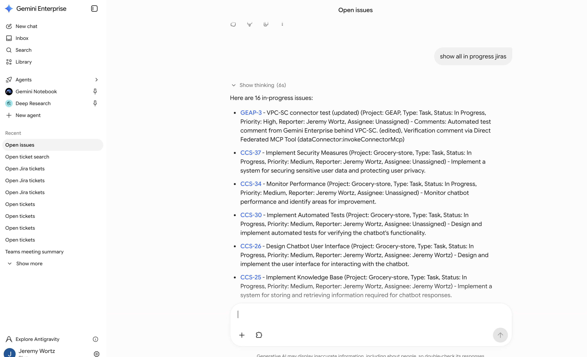
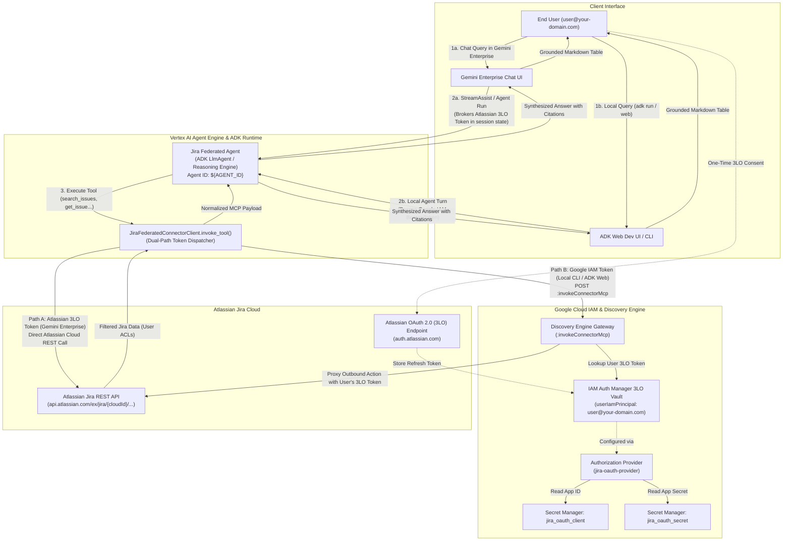
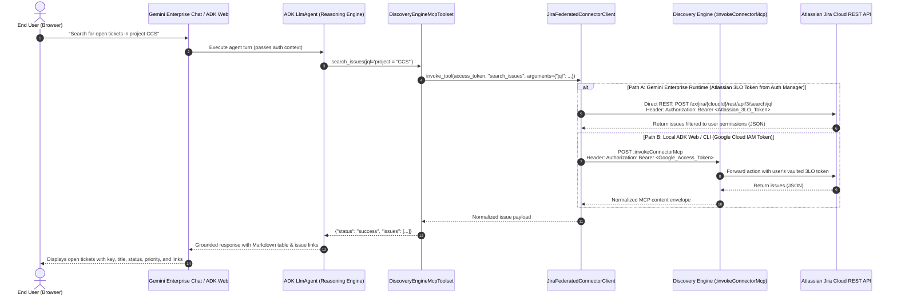
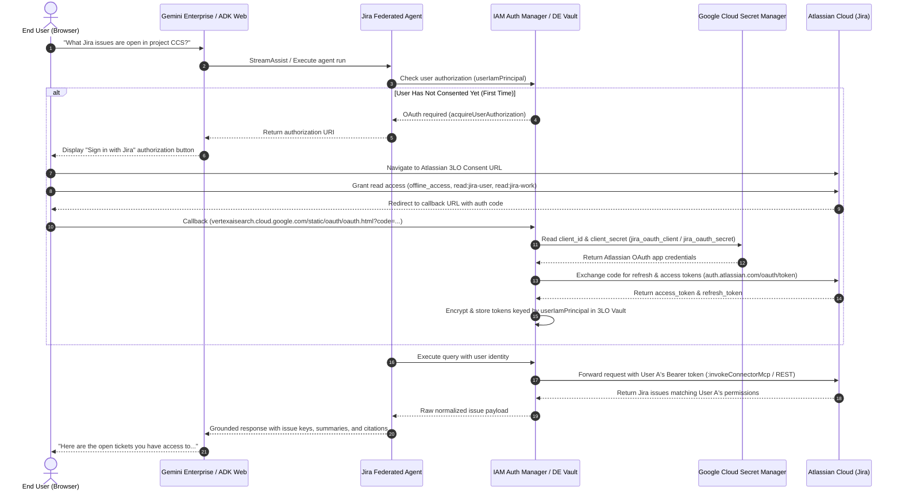

# Gemini Enterprise Jira Federated Connector — ADK RAG Agent (`gemini-jira-federated`)

This repository demonstrates how to build a grounded **Google Agent Development Kit (ADK)** agent over a **Gemini Enterprise (Discovery Engine) Federated Jira Data Connector** (`connectorType: "THIRD_PARTY_FEDERATED"`) using **end-user OAuth2 authentication (3-Legged OAuth / 3LO)** backed by **Google Cloud IAM Auth Manager** and **Google Cloud Secret Manager**.


*Live Grounded Jira Issue Retrieval in Gemini Enterprise using Direct Federated MCP (`dataConnector:invokeConnectorMcp`)*

---

## Architecture & End-User 3LO Auth Manager Integration

When generative AI agents interact with third-party SaaS systems like Jira, they must authenticate outbound requests securely. Rather than using static service account API tokens (which would expose all corporate Jira tickets to all users), this architecture implements **delegated user identity (3-Legged OAuth / 3LO)** via the **Google Cloud IAM Auth Manager** and Discovery Engine Authorization Services.

> [!NOTE]
> For official Google Cloud architectural principles on agent credential brokering, see the [Google Cloud IAM Auth Manager Overview](https://docs.cloud.google.com/iam/docs/auth-manager-overview), [Agent Identity Auth Manager Overview](https://cloud.google.com/iam/docs/agent-identity-auth-manager-overview), and [Authenticate using 3-legged OAuth with auth manager](https://cloud.google.com/iam/docs/agent-identity-auth-manager-oauth3).

### Component Architecture



---

### Sequence Flow: Dual-Path Jira Invocation (Gemini Enterprise vs. Local ADK)



---

### End-to-End 3-Legged OAuth Sequence Flow



---

## How End-User Credentials & Data Isolation Work

### 1. Zero Shared Master Credentials
In standard API-key architectures, an application shares a single service account token across all queries. If an agent executes a query on behalf of User A, the service account could inadvertently expose issues from confidential projects that User A has no permission to view in Jira.

### 2. IAM Principal Keying (`userIamPrincipal`)
Google Cloud's Auth Manager binds each Atlassian OAuth refresh token directly to the calling Google Cloud IAM Principal (e.g. `userIamPrincipal: user@your-domain.com`).
- **User A** only retrieves tickets visible to User A in Atlassian Jira.
- **User B** only retrieves tickets visible to User B in Atlassian Jira.
- Atlassian's native Issue Security Schemes, Project Permissions, and Role-Based Access Controls (RBAC) are fully preserved.

### 3. Secret Manager Security (Pattern 2)
The OAuth App Client ID and Client Secret are stored in Google Cloud Secret Manager:
- `projects/${PROJECT_NUMBER}/secrets/${JIRA_OAUTH_CLIENT_SECRET_NAME}`
- `projects/${PROJECT_NUMBER}/secrets/${JIRA_OAUTH_SECRET_SECRET_NAME}`

Access is restricted via IAM to the Discovery Engine service agent (`service-${PROJECT_NUMBER}@gcp-sa-discoveryengine.iam.gserviceaccount.com`) and Compute Engine SA (`roles/secretmanager.secretAccessor`). No secrets are ever stored in plain text or Git.

---

## Troubleshooting & The Atlassian 3LO Error Fix

### The Problem
When clicking the Jira sign-in link, users previously encountered:
```text
Hmm... We're having trouble logging you in.
The authorize request was incomplete or invalid. Start again from the app to initiate sign-in and ensure the link includes all required details. Contact the app developer for further help.
error: invalid_request
error_description: Incorrect request parameters
00177fd7-175a-11fb-46de-94e89f6fd34b
```

### The Root Cause
1. **Missing `response_type=code`**: RFC 6749 and Atlassian 3LO strictly require `response_type=code`. Discovery Engine's internal authorization URL builder does **not** automatically inject `response_type`; it expects it within the `authorizationUri` template.
2. **Missing `redirect_uri`**: Atlassian requires `redirect_uri=https%3A%2F%2Fvertexaisearch.cloud.google.com%2Fstatic%2Foauth%2Foauth.html` matching the callback URL configured in the Atlassian Developer Console.
3. **Scope Family Mismatch**: Atlassian separates scopes into **Classic** (`offline_access`, `read:jira-user`, `read:jira-work`) and **Granular** (`read:issue:jira`). Requesting a granular scope on an app configured with classic scopes causes Atlassian to reject the authorize request as `invalid_request`.

### The Fix
In `scripts/setup_jira_auth_provider.py`, the `authorizationUri` is configured as:
```text
https://auth.atlassian.com/authorize?audience=api.atlassian.com&redirect_uri=https%3A%2F%2Fvertexaisearch.cloud.google.com%2Fstatic%2Foauth%2Foauth.html&response_type=code&prompt=consent
```
With classic scopes:
```python
DEFAULT_SCOPES = [
    "offline_access",
    "read:jira-user",
    "read:jira-work",
]
```

When Discovery Engine executes `acquireUserAuthorization`, it produces the complete, RFC-compliant 3LO URL:
```text
https://auth.atlassian.com/authorize?audience=api.atlassian.com&redirect_uri=https%3A%2F%2Fvertexaisearch.cloud.google.com%2Fstatic%2Foauth%2Foauth.html&response_type=code&prompt=consent&client_id=RyA0UoXKSMmuQqEDMSLnOZQCzM0Eadic&scope=offline_access+read:jira-user+read:jira-work&state=...
```

---

## Target Data Source (Configured via `.env`)
Configure your target Discovery Engine app and Jira connector in `.env` (see [`.env.example`](.env.example)):
- **GCP Project**: `DISCOVERY_ENGINE_PROJECT_ID` (`DISCOVERY_ENGINE_PROJECT_NUMBER`)
- **Discovery Engine App / Engine**: `DISCOVERY_ENGINE_ID` (`grocery-workshop-engine`, `global`)
- **Data Connector Collection**: `JIRA_CONNECTOR_COLLECTION_ID` (e.g. `jira-federated_...`)
- **Atlassian Jira Cloud Instance**: `JIRA_INSTANCE_URI` (e.g. `https://<tenant>.atlassian.net`)

---

## Federated MCP Integration (`DiscoveryEngineMcpToolset`)

Discovery Engine federated connectors (`jira-federated_...`) natively expose Model Context Protocol (MCP) actions over a single Google Cloud REST/gRPC endpoint:

```http
POST https://discoveryengine.googleapis.com/v1alpha/projects/{project}/locations/{location}/collections/{collection}/dataConnector:invokeConnectorMcp
Authorization: Bearer <GOOGLE_ACCESS_TOKEN>
x-goog-user-project: <PROJECT_ID>
Content-Type: application/json
```

### Request Flow
1. **Dynamic MCP Tool Discovery**: `DiscoveryEngineMcpToolset` queries Discovery Engine (`tools/list`) and translates Jira MCP tool definitions directly into native ADK tools for the LLM (Gemini 2.5 Flash).
2. **Google Cloud Authentication**: The agent invokes `dataConnector:invokeConnectorMcp` using the user's Google Cloud access token (brokered through ADK credentials).
3. **IAM Auth Manager Lookup**: Discovery Engine identifies the caller and queries the **Google Cloud IAM Auth Manager** token vault for that user's linked Atlassian Jira 3LO OAuth token.
4. **Secure Atlassian Proxy**: Discovery Engine dispatches the native MCP tool call to Atlassian Jira Cloud (`https://api.atlassian.com/ex/jira/{cloudId}/...`) using the user's delegated Atlassian Bearer token.
5. **Normalized Response**: Discovery Engine returns the normalized JSON payload inside an MCP content envelope (`{"result": {"isError": false, "content": [{"type": "text", "text": "..."}]}}`).

### Native MCP Tools Registered on the Agent

| MCP Tool Name | Schema & Arguments | Description |
| :--- | :--- | :--- |
| **`search_issues`** | `jql: string` | Searches issues with JQL (e.g., `project = "CCS" AND status != "Done"`). Gemini writes native JQL directly. |
| **`get_issue`** | `issueIdOrKey: string` | Fetches full issue details by key (e.g., `CCS-50`, `GEAP-3`), including status, priority, reporter, assignee, and comments. |
| **`list_projects`** | `query?: string` | Lists all Jira projects accessible to the authenticated user. |
| **`create_comment`** | `issueIdOrKey: string, comment: string` | Posts a new comment to an existing Jira issue. |
| **`create_issue`** | `projectKey: string, summary: string, issueType?: string, description?: string` | Files a new ticket in Jira Cloud. |

> [!NOTE]
> Authorization checks and 3LO consent handling are performed programmatically by `DiscoveryEngineMcpToolset` / `JiraFederatedConnectorClient` rather than exposed as standalone LLM tools (`check_jira_oauth_status`, `complete_jira_oauth_consent`). This prevents the model from hallucinating or jumping into auth checks prematurely when the user is already authorized.

---

## How We Used Google Cloud IAM Auth Manager & Direct Federated MCP

### 1. Pattern 2 Authorization Setup
We configured Discovery Engine's Authorization Provider (`projects/${PROJECT_NUMBER}/locations/${LOCATION}/authorizations/${AUTH_PROVIDER_ID}`) to reference OAuth App credentials stored securely in Google Cloud Secret Manager:
- **Client ID Secret**: `projects/${PROJECT_NUMBER}/secrets/${JIRA_OAUTH_CLIENT_SECRET_NAME}`
- **Client Secret**: `projects/${PROJECT_NUMBER}/secrets/${JIRA_OAUTH_SECRET_SECRET_NAME}`
- **Atlassian 3LO Authorization URI**:
  ```text
  https://auth.atlassian.com/authorize?audience=api.atlassian.com&redirect_uri=https%3A%2F%2Fvertexaisearch.cloud.google.com%2Foauth-redirect&response_type=code&prompt=consent
  ```
- **Atlassian Token URI**: `https://auth.atlassian.com/oauth/token`
- **OAuth Scopes**: `offline_access`, `read:jira-user`, `read:jira-work`

### 2. User Authorization Vault Handshake
When an end-user first interacts with the agent or clicks the sign-in link:
1. The user authenticates with Atlassian Jira Cloud and approves delegated access.
2. Atlassian redirects with an authorization code to `https://vertexaisearch.cloud.google.com/oauth-redirect?code=...`.
3. Discovery Engine exchanges the authorization code for a Jira refresh token using the Secret Manager credentials.
4. The refresh token is encrypted and stored in Discovery Engine's Auth Manager vault, securely indexed by the user's Google Cloud IAM Principal (`userIamPrincipal: <user_email>`).

### 3. Direct MCP Dispatch via `invokeConnectorMcp`
When an agent tool executes:
1. The agent client [`JiraFederatedConnectorClient`](jira_federated_agent/jira_connector_client.py) prepares an MCP JSON-RPC payload:
   ```python
   payload = {
       "method": "tools/call",
       "params": {
           "name": "search_issues",
           "arguments": {
               "query": "created is not null order by created desc",
               "maxResults": 20,
           },
       },
       "engine": f"projects/{project_number}/locations/{location}/collections/default_collection/engines/{engine_id}",
   }
   ```
2. The agent issues a `POST` request to `https://discoveryengine.googleapis.com/v1alpha/projects/{project_number}/locations/{location}/collections/{collection_id}/dataConnector:invokeConnectorMcp` authenticated with the caller's Google access token (`Authorization: Bearer ya29...`).
3. Discovery Engine verifies caller permissions (`discoveryengine.dataConnectors.executeAction`), resolves the caller's identity, retrieves that specific user's Atlassian 3LO access token from the Auth Manager vault, forwards the request to Jira Cloud, and returns the response in standard MCP format:
   ```json
   {
     "result": {
       "isError": false,
       "content": [
         {
           "type": "text",
           "text": "{\"result\":{\"results\":[{\"key\":\"GEAP-3\",\"title\":\"VPC-SC connector test\"...}]}}"
         }
       ]
     }
   }
   ```
4. The client unwraps the MCP content envelope and extracts the structured JSON, returning clean dictionaries to the ADK agent.

---

## Gemini Enterprise MCP Connectors & Agent Registry Architecture

Newer Gemini Enterprise DataConnector resources natively serve Model Context Protocol (MCP) interactions through two official, complementary surfaces in Google Cloud:

```mermaid
flowchart TD
    subgraph PatternA["Pattern A: Direct Federated MCP (Current Production Baseline)"]
        AgentA["ADK LlmAgent"]
        ToolsetA["DiscoveryEngineMcpToolset\n(In-Process ADK BaseToolset)"]
        DEA["Discovery Engine Gateway\nPOST :invokeConnectorMcp"]
        VaultA["Auth Manager 3LO Vault\n(userIamPrincipal)"]
        JiraA["Atlassian Jira Cloud"]

        AgentA --> ToolsetA
        ToolsetA -->|"Google Bearer Token\nx-goog-user-project"| DEA
        DEA --> VaultA
        DEA --> JiraA
    end

    subgraph PatternB["Pattern B: Agent Registry & Streamable-HTTP (Next-Gen Fleet Pattern)"]
        AgentB["ADK LlmAgent"]
        RegB["google.adk.integrations.agent_registry.AgentRegistry"]
        McpB["McpToolset (StreamableHTTP)\nPOST/GET/DELETE .../dataConnector/mcp"]
        CredsB["google-adk[agent-identity]\n(GcpAuthProviderScheme)"]
        DEB["DataConnectorMcpService\n(Streamable-HTTP SSE)"]

        AgentB --> RegB
        RegB --> McpB
        McpB <--> CredsB
        McpB -->|"Requires Agent Registry + Agent Gateway / IAP"| DEB
    end
```



### Pattern A: Direct Federated MCP (`:invokeConnectorMcp`)
- **API Method**: `POST https://discoveryengine.googleapis.com/v1alpha/projects/{project_number}/locations/{location}/collections/{collection}/dataConnector:invokeConnectorMcp`
- **Deployment Status**: **Live in Production across all Discovery Engine regions.**
- **Authentication**: Standard Google Cloud Bearer Token (`Authorization: Bearer $(gcloud auth print-access-token)`) with `x-goog-user-project`.
- **ADK Integration**: Uses the in-process `DiscoveryEngineMcpToolset` (subclass of ADK `BaseToolset`), executing `:invokeConnectorMcp` directly in Python memory with zero subprocess overhead and propagating per-request caller OAuth tokens.
- **Advantages**: Completely hermetic, zero external registry configuration required, runs in local CLI, `adk web`, Cloud Run, and Vertex AI Agent Engine today without additional plugins.

### Pattern B: Google Cloud Agent Registry & Streamable-HTTP (`/dataConnector/mcp`)
- **API Method**: `https://discoveryengine.googleapis.com/v1/projects/{project_number}/locations/{location}/collections/{collection}/dataConnector/mcp`
- **Deployment Status**: **Live in Production on Discovery Engine** (implements full MCP Streamable-HTTP spec with `POST`, `GET` SSE streaming, and `DELETE` session termination).

#### 1. How the Connector is Registered as an MCP Server
When a Federated DataConnector (such as `jira-federated_...`) is created in Gemini Enterprise / Discovery Engine, Google automatically provisions an MCP Server resource in **Google Cloud Agent Registry** (`agentregistry.googleapis.com`):
```bash
# Inspect the registered MCP server in Google Cloud Agent Registry
gcloud alpha agent-registry mcp-servers describe \
  agentregistry-00000000-0000-0000-cdb8-8607e74a4bcf \
  --location=global \
  --project="${PROJECT_ID}"
```

The registered resource contains:
- **`RuntimeReference`**: Points back to the parent Discovery Engine DataConnector (`//discoveryengine.googleapis.com/projects/${PROJECT_NUMBER}/locations/global/collections/${COLLECTION_ID}/dataConnector`).
- **`interfaces`**: Advertises the Streamable-HTTP endpoint (`https://discoveryengine.googleapis.com/v1/.../dataConnector/mcp`) with `protocolBinding: "JSONRPC"`.
- **`mcpServerId`**: Unique URN (`urn:mcp:projects-...:dataConnector`).
- **`tools`**: Declarations for native Jira operations (`create_issue`, `update_issue`, `change_issue_status`, `create_comment`, `update_comment`, `upload_attachment`).

#### 2. Identity-Aware Proxy (IAP) Access & Egress JWT Assertions
The `/dataConnector/mcp` endpoint is protected by Google Cloud Identity-Aware Proxy (IAP) and Vertex AI Agent Gateway:
- **Inside Vertex AI Agent Engine / Agent Gateway**: The runtime automatically injects an IAP Egress JWT Assertion header (`x-goog-iap-egress-jwt-assertion`) into outbound calls. This assertion cryptographically signs the caller's Google identity (`userIamPrincipal`), allowing Discovery Engine to look up the caller's delegated Jira 3LO OAuth token in Auth Manager.
- **Outside Agent Gateway (Local CLI / Raw HTTP)**: Invoking `/dataConnector/mcp` directly without the Agent Gateway IAP header fails with:
  `generic::invalid_argument: The request was invalid: failed to fetch request headers`
- **Why Pattern A is Used for Standalone Runtimes**: Pattern A (`:invokeConnectorMcp`) authenticates directly via standard Google Bearer tokens (`Authorization: Bearer $(gcloud auth print-access-token)`), allowing hermetic execution anywhere (local CLI, `adk web`, Cloud Run, and tests) without needing an Agent Gateway mesh.

#### 3. What Was `JIRA_MCP_TRANSPORT=builtin|inprocess`?
In earlier revisions of the codebase, we provided an environment toggle:
- **`JIRA_MCP_TRANSPORT=builtin`**: Used ADK's `google.adk.tools.mcp_tool.McpToolset` with `StdioConnectionParams`, spawning `jira_federated_agent.mcp_server` as a local subprocess that bridged MCP stdio JSON-RPC calls into Discovery Engine REST calls.
- **`JIRA_MCP_TRANSPORT=inprocess`**: Used `DiscoveryEngineMcpToolset` (an ADK `BaseToolset` subclass) to call `:invokeConnectorMcp` directly in Python memory.

**Why it was streamlined**:
We eliminated `mcp_server.py` and the `JIRA_MCP_TRANSPORT` toggle to produce a clean, production-grade codebase:
- `jira_federated_agent` now directly uses [`DiscoveryEngineMcpToolset`](jira_federated_agent/mcp_toolset.py) 100% in-process.
- Zero subprocess startup delay, zero stdio pipe serialization, and zero deprecation warnings.
- Preserves the same external tool schema and 3LO Auth Manager security model.

#### 4. ADK Code Pattern for Agent Registry:
```python
import os
from google.adk.agents import LlmAgent
from google.adk.auth.credential_manager import CredentialManager
from google.adk.integrations.agent_identity import GcpAuthProvider
from google.adk.integrations.agent_registry import AgentRegistry

project_id = os.environ.get("PROJECT_ID")
location = os.environ.get("DISCOVERY_ENGINE_LOCATION", "global")

# Register Agent Identity Auth Provider for automated 3LO brokering
CredentialManager.register_auth_provider(GcpAuthProvider())

# Initialize Agent Registry client
registry = AgentRegistry(project_id=project_id, location=location)

# Auto-resolve connector Streamable-HTTP URI and IAM bindings
mcp_toolset = registry.get_mcp_toolset(
    mcp_server_name=f"projects/{project_id}/locations/{location}/mcpServers/agentregistry-00000000-0000-0000-cdb8-8607e74a4bcf",
    continue_uri="https://vertexaisearch.cloud.google.com/oauth-redirect",
)

# Pass directly to ADK agent
root_agent = LlmAgent(
    name="jira_agent_registry",
    model="gemini-2.5-flash",
    tools=[mcp_toolset],
)
```
- **Requirements**:
  1. `pip install "google-adk[agent-identity]" "google-adk[a2a]"`
  2. Runtime execution behind Vertex AI Agent Gateway / IAP Egress, or authenticated via `GcpAuthProviderScheme`.

---

## Architecture Decision Record (ADR): Why In-Process DiscoveryEngineMcpToolset Was Chosen

Throughout development, we empirically evaluated five potential architectures for integrating Gemini Enterprise Federated Jira MCP tools with Google ADK:

| Architecture | Transport | Runs Locally & in Tests? | Handles 3LO per User? | Gemini Writes Native JQL? | Architectural Assessment |
| :--- | :---: | :---: | :---: | :---: | :--- |
| **1. Manual Tool Wrappers**<br>(8 handcoded functions + REST fallback) | In-process | ✅ Yes | ⚠️ Fragile (manual header juggling) | ❌ No (manual query string params) | 🔴 **Legacy / Bloated**: 1,006 lines in client, duplicate REST parsing, complex ADF text converters. |
| **2. Stdio Subprocess Bridge**<br>(`McpToolset` + `mcp_server.py`) | Subprocess (`python -m ...`) | ✅ Yes | ⚠️ Global env token only | ✅ Yes | 🟡 **Suboptimal**: Spawns a background Python process on stdin/stdout; JSON-RPC serialization latency; deprecated `MCPTool` warnings. |
| **3. Direct `McpToolset` Streamable-HTTP**<br>(`/dataConnector/mcp` + `auth_scheme`) | HTTP SSE Stream | ❌ **Fails** (`failed to fetch request headers`) | ❌ Blocked | ✅ Yes | 🔴 **Broken outside Agent Gateway**: Requires Google internal `x-goog-iap-egress-jwt-assertion` header (b/576499827). |
| **4. Pure Agent Registry**<br>(`AgentRegistry.get_mcp_toolset`) | Streamable-HTTP via SDK | ❌ **Fails outside Gateway** | ✅ (Via `agent-identity`) | ✅ Yes | 🟢 **Future Production Target**: 1-line initialization, but currently blocked on the same IAP header when running standalone. |
| **5. In-Process `DiscoveryEngineMcpToolset`** | **100% In-Process** | ✅ **Yes (100% hermetic)** | ✅ **Yes (Dynamic via `ToolContext`)** | ✅ **Yes** | 🟢 **Current Production Baseline**: Native ADK `BaseToolset`, 0 subprocesses, net -237 lines pruned, 43/44 tests pass in 8.3s. |

### Key Reasons for Adopting Option 5:
1. **Zero Subprocess Overhead**: Unlike Option 2, it executes directly in Python memory without pipe serialization or spawning background processes.
2. **Reliable Anywhere**: Works seamlessly in local CLI, `adk web`, Cloud Run, and CI/CD without tripping over the Agent Gateway IAP assertion requirement.
3. **Per-Turn User 3LO Delegated Auth**: Receives `ToolContext` on every chat turn, extracts the active caller's OAuth token (`temp:jira_oauth_provider`), verifies Auth Manager authorization, and passes it forward.
4. **Standard ADK BaseToolset**: Directly subclasses `BaseToolset` (the exact base class `McpToolset` inherits from), providing identical native `FunctionDeclaration` schemas to Gemini.

---

## Secret Management & Zero-Ingestion Security Model

This codebase enforces strict Google Cloud Secret Management hygiene across all layers:

1. **OAuth App Credentials (Secret Manager Pattern 2)**:
   - `jira_oauth_client` and `jira_oauth_secret` reside exclusively in **Google Cloud Secret Manager** (`projects/${PROJECT_NUMBER}/secrets/...`), never in application code or local git configs.
   - Discovery Engine's Authorization Provider (`jira-oauth-provider`) accesses the secrets server-to-server via IAM (`roles/secretmanager.secretAccessor`).
   - Setup scripts prompt via `getpass.getpass()` and automatically mask secrets in dry-run logs (`clientSecret: "******"`).

2. **End-User 3LO Tokens (Zero Token Ingestion)**:
   - The agent **never ingests, holds, or persists** the user's Atlassian refresh token.
   - During consent, the temporary authorization code in the redirect URI is exchanged directly by Discovery Engine via `:acquireAndStoreRefreshToken`.
   - Discovery Engine encrypts and stores the refresh token in Google Cloud's **IAM Auth Manager Vault**, indexed by the user's Google identity (`userIamPrincipal`).
   - Outbound tool executions (`:invokeConnectorMcp`) retrieve the token server-side within Google's infrastructure perimeter. The agent only receives scrubbed MCP JSON payloads.

3. **Repository Sanitization**:
   - Zero hardcoded API keys, private keys, or OAuth access tokens across all tracked files.
   - Zero hardcoded project IDs or project numbers (100% parameterized via environment variables).
   - `.gitignore` strictly ignores `.env`, `*.secret`, `*credentials*.json`, and `.adk/`.
   - `logger.*` and `print()` statements across the codebase never output tokens, authorization headers, or sensitive payloads.

---

## Required Google Cloud APIs & IAM Roles

### 1. Required Google Cloud APIs
To operate this architecture, the following Google Cloud APIs must be enabled in your GCP project:

| API Service Name | Service Endpoint | Purpose |
| :--- | :--- | :--- |
| **Discovery Engine API** | `discoveryengine.googleapis.com` | Gemini Enterprise engines, federated data connectors, Auth Manager authorizations, and `:invokeConnectorMcp` endpoint. |
| **Vertex AI API** | `aiplatform.googleapis.com` | Vertex AI Gemini models, Reasoning Engines, Agent Engine, and ADK agent hosting. |
| **Secret Manager API** | `secretmanager.googleapis.com` | Secure storage of OAuth App Client ID and Client Secret (Pattern 2). |
| **IAM API** | `iam.googleapis.com` | Service account management, IAM policy bindings, and identity federation. |
| **IAM Credentials API** | `iamcredentials.googleapis.com` | Short-lived OAuth2 access token generation and service account impersonation. |
| **Service Usage API** | `serviceusage.googleapis.com` | Service enablement and quota management. |
| **Cloud Resource Manager API** | `cloudresourcemanager.googleapis.com` | Project-level IAM policy queries and resource management. |

Enable all required APIs with a single `gcloud` command:
```bash
gcloud services enable \
  discoveryengine.googleapis.com \
  aiplatform.googleapis.com \
  secretmanager.googleapis.com \
  iam.googleapis.com \
  iamcredentials.googleapis.com \
  serviceusage.googleapis.com \
  cloudresourcemanager.googleapis.com \
  --project="${PROJECT_ID}"
```

### 2. External Third-Party APIs
- **Atlassian OAuth 2.0 (3LO) Endpoint**: `https://auth.atlassian.com` (`/authorize`, `/oauth/token`)
- **Atlassian Cloud REST API**: `https://api.atlassian.com` (`/oauth/token/accessible-resources`, `/ex/jira/{cloudId}/rest/api/3/...`)

### 3. Required IAM Roles & Permissions

| Identity | Required IAM Role | Purpose |
| :--- | :--- | :--- |
| **Calling User** (`${OAUTH_USER_ACCOUNT}`) | `roles/discoveryengine.admin` | Access Gemini Enterprise search apps and execute data connector actions (`discoveryengine.dataConnectors.executeAction`). |
| | `roles/aiplatform.user` | Query Vertex AI reasoning engines and Gemini models. |
| | `roles/secretmanager.viewer` | Verify OAuth secret metadata. |
| **Discovery Engine Service Agent** (`service-${PROJECT_NUMBER}@gcp-sa-discoveryengine.iam.gserviceaccount.com`) | `roles/secretmanager.secretAccessor` | Read `jira_oauth_client` and `jira_oauth_secret` from Secret Manager during OAuth exchange. |
| **Vertex AI Reasoning Engine / Compute SA** (`${PROJECT_NUMBER}-compute@developer.gserviceaccount.com`) | `roles/discoveryengine.admin` | Execute `dataConnector:invokeConnectorMcp` and query Discovery Engine on behalf of the agent container. |
| | `roles/secretmanager.secretAccessor` | Read OAuth secrets if required for local/headless operations. |

---

## Setup & Deployment Guide

### 1. Activate the Python Virtual Environment
You can activate the local environment directly:
```bash
source .venv/bin/activate
```
Or run any tool with `uv run`:
```bash
cd gemini-jira-federated
uv run pytest -v
```

### 2. Configure Atlassian Developer Console
In your Atlassian App ([developer.atlassian.com/console/myapps](https://developer.atlassian.com/console/myapps)):
1. Navigate to **Authorization** -> **OAuth 2.0 (3LO)** -> **Configure**.
2. Add the Google Cloud Callback URL:
   ```text
   https://vertexaisearch.cloud.google.com/static/oauth/oauth.html
   ```
3. Under **Permissions (Scopes)**, add:
   - `offline_access`
   - `read:jira-user`
   - `read:jira-work`

### 3. Provision Pattern 2 (Secret Manager + Auth Provider)
Run the automated setup script to store credentials, grant IAM permissions, create the Discovery Engine Authorization, and bind it to the registered Gemini Enterprise agent:
```bash
# Sourcing the environment
source .venv/bin/activate

# Execute setup
python scripts/setup_jira_auth_provider.py \
  --project-id="${PROJECT_ID}" \
  --project-number="${PROJECT_NUMBER}" \
  --engine-id="grocery-workshop-engine" \
  --agent-id="${GEMINI_ENTERPRISE_AGENT_ID}"
```

### 4. Run Unit & Live Tests
```bash
uv run pytest -v
```

### 5. Launch `adk web` Locally
```bash
uv run adk web --host 127.0.0.1 --port 8000
```
Open **`http://127.0.0.1:8000/dev-ui/?app=jira_federated_agent`** in your browser.


*Local Interactive 3-Legged OAuth & Agent Execution in ADK Web Dev UI*

### 6. Deployment Status & Updating Live Deployment

#### Current GCP Deployment State
- **Vertex AI Reasoning Engine**: `projects/${PROJECT_NUMBER}/locations/us-central1/reasoningEngines/1626276928405110784`
- **Gemini Enterprise Agent**: `projects/${PROJECT_NUMBER}/locations/global/collections/default_collection/engines/grocery-workshop-engine/assistants/default_assistant/agents/16003540595574963813`
- **Deployment Status**: Live in production. The remote Reasoning Engine was updated on **Oct 29, 2026 (15:35 UTC)** with dual-path 3LO token routing and direct Atlassian REST support from `feature/adk-mcp-toolset`.

#### Updating the Live Vertex AI Agent Engine Deployment
To redeploy the latest in-process code to the existing Reasoning Engine in `us-central1`:
```bash
# Sourcing environment variables
source .venv/bin/activate

# Execute deploy script
uv run python scripts/deploy_agent_engine.py
```

---

## References & Documentation
- [Google Cloud IAM Auth Manager Overview](https://docs.cloud.google.com/iam/docs/auth-manager-overview)
- [Agent Identity Auth Manager Overview](https://cloud.google.com/iam/docs/agent-identity-auth-manager-overview)
- [Authenticate using 3-legged OAuth with Auth Manager](https://cloud.google.com/iam/docs/agent-identity-auth-manager-oauth3)
- [Manage Agent Identity Auth Providers](https://cloud.google.com/iam/docs/agent-identity-manage-auth-providers)
- [Google Cloud Agent Identity Overview](https://cloud.google.com/iam/docs/agent-identity-overview)
- [Atlassian OAuth 2.0 (3LO) Apps Documentation](https://developer.atlassian.com/cloud/jira/platform/oauth-2-3lo-apps/)
- [RFC 6749: The OAuth 2.0 Authorization Framework](https://datatracker.ietf.org/doc/html/rfc6749)
