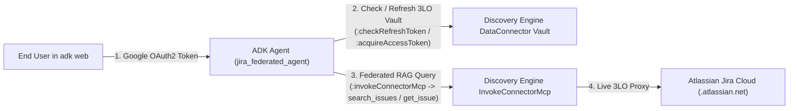

# Gemini Enterprise Jira Federated Connector — ADK RAG Agent (`gemini-jira-federated`)

This repository demonstrates how to build a grounded **Google Agent Development Kit (ADK)** agent over a **Gemini Enterprise (Discovery Engine) Federated Jira Data Connector** (`connectorType: "THIRD_PARTY_FEDERATED"`) using **end-user OAuth2 authentication**.


## Target Data Source (Configured via `.env`)
Configure your target Discovery Engine app and Jira connector in `.env` (see [`.env.example`](.env.example)):
- **GCP Project**: `DISCOVERY_ENGINE_PROJECT_ID` (`DISCOVERY_ENGINE_PROJECT_NUMBER`)
- **Discovery Engine App / Engine**: `DISCOVERY_ENGINE_ID` (`global`)
- **Data Connector Collection**: `JIRA_CONNECTOR_COLLECTION_ID` (e.g. `jira-federated_...`)
- **Entity Data Stores (10)**:
  - `_issue`, `_bug`, `_epic`, `_story`, `_task`, `_comment`, `_attachment`, `_project`, `_worklog`, `_board`
- **Atlassian Jira Cloud Instance**: `JIRA_INSTANCE_URI` (e.g. `https://<tenant>.atlassian.net`)

---

## Why Standard `VertexAiSearchTool` Alone Returns `[]` on Federated Connectors

In `THIRD_PARTY_FEDERATED` mode (`incrementalSyncDisabled: true`), **zero documents are indexed in Google Cloud Branch 0**. Furthermore, Unified Federated Connectors (`dataSource: "jira"`, `connectorModes: ["FEDERATED", "ACTIONS"]`) execute live federated queries through Discovery Engine's `DataConnectorService.InvokeConnectorMcp` (`:invokeConnectorMcp`) using the calling user's 3-Legged OAuth (3LO) token stored in Discovery Engine's `userStores` vault.



### How OAuth Works in This Repo
1. **Google OAuth Identity Resolution (`jira_federated_agent/auth.py`)**:
   - Supports **ADK Web interactive OAuth2** (`AuthConfig` / `tool_context.request_credential`) when `ADK_INTERACTIVE_OAUTH=true` and `OAUTH_CLIENT_ID` / `OAUTH_CLIENT_SECRET` are set.
   - Automatically resolves the authenticated user's Google OAuth token (`OAUTH_USER_ACCOUNT`) and bridges `google.auth.default()` in memory so both Vertex AI (`gemini-2.5-flash`) and Discovery Engine authenticate as the user without writing secret files to disk.
2. **Discovery Engine 3LO Jira Vault & Consent (`jira_federated_agent/jira_connector_client.py`)**:
   - `check_jira_oauth_status`: Calls `:checkRefreshToken`, `widgetConfigs/default_search_widget_config`, and `:acquireAccessToken` on the target connector collection to verify the user's linked Atlassian 3LO OAuth token and scopes (`read:jira-work`, `read:jira-user`, `offline_access`).
   - If a user has not yet linked their Atlassian account, `check_jira_oauth_status` returns the exact `authorization_uri` (`https://auth.atlassian.com/authorize?...`), and `complete_jira_oauth_consent(redirect_url)` exchanges the callback code via `:acquireAndStoreRefreshToken`.
3. **Live Federated Jira Retrieval (`jira_federated_agent/agent.py`)**:
   - `search_jira_issues`: Executes federated JQL and keyword searches via `:invokeConnectorMcp` (`search_issues`) with input validation and ADF (Atlassian Document Format) text extraction.
   - `get_jira_issue`: Retrieves full details and comments for a specific issue key (e.g., `GEAP-3`, `GEAP-2`, `CCS-68`, `CCS-50`).
   - `list_jira_projects`: Lists or searches Jira projects (`CCS` / `Grocery-store`, `GEAP`, etc.).

---

## Quickstart

### 1. Install Dependencies & Run Tests
```bash
cd ~/gemini-jira-federated
~/.local/bin/uv sync --extra dev

# Run unit + live integration tests
~/.local/bin/uv run pytest -v
```

### 2. Launch `adk web`
```bash
cd ~/gemini-jira-federated
~/.local/bin/uv run adk web --host 127.0.0.1 --port 8000
```

Open **`http://127.0.0.1:8000/dev-ui/?app=jira_federated_agent`** in your browser and try prompts such as:
- *"Check my Jira OAuth status and list all Jira projects."*
- *"What Jira issues can you see in the federated connector?"*
- *"Search for Jira issues related to Snowflake migration or VPC-SC."*
- *"Show me the full details and comments on issue GEAP-3."*
