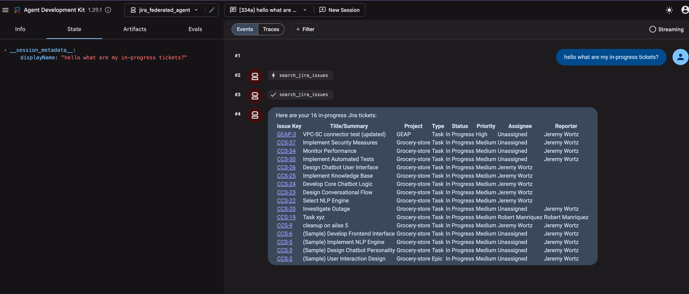
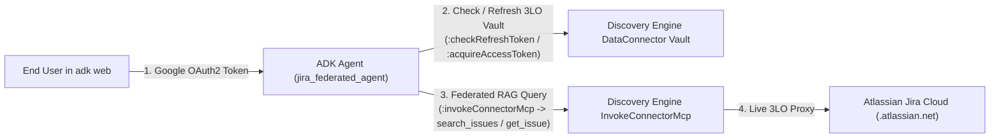

# Gemini Enterprise Jira Federated Connector — ADK RAG Agent (`gemini-jira-federated`)

This repository demonstrates how to build a grounded **Google Agent Development Kit (ADK)** agent over a **Gemini Enterprise (Discovery Engine) Federated Jira Data Connector** (`connectorType: "THIRD_PARTY_FEDERATED"`) using **end-user OAuth2 authentication**.



## Target Data Source (Configured via `.env`)
Configure your target Discovery Engine app and Jira connector in `.env` (see [`.env.example`](.env.example)):
- **GCP Project**: `DISCOVERY_ENGINE_PROJECT_ID` (`DISCOVERY_ENGINE_PROJECT_NUMBER`)
- **Discovery Engine App / Engine**: `DISCOVERY_ENGINE_ID` (`global`)
- **Data Connector Collection**: `JIRA_CONNECTOR_COLLECTION_ID` (e.g. `jira-federated_...`)
- **Entity Data Stores (10)**:
  - `_issue`, `_bug`, `_epic`, `_story`, `_task`, `_comment`, `_attachment`, `_project`, `_worklog`, `_board`
- **Atlassian Jira Cloud Instance**: `JIRA_INSTANCE_URI` (e.g. `https://<tenant>.atlassian.net`)

---

## Retrieval Modes (`JIRA_RETRIEVAL_MODE`)

This agent supports two complementary retrieval strategies over the federated connector:

| Retrieval Mode | Primary API Endpoint | Strengths & Characteristics | Best For |
| :--- | :--- | :--- | :--- |
| **`mcp`** *(Default)* | `dataConnector:invokeConnectorMcp` | **Autonomous multi-turn planner loop**: Retries with broader filters if results are empty; bypasses the 50-item sample count ceiling; parses normalized issue fields & comments. | Complex lookups, multi-step queries, count/status verification, debugging. |
| **`stream_assist`** | `assistants/default_assistant:streamAssist` | **Native Gemini Enterprise Assistant**: Queries across all 10 per-entity data stores simultaneously; returns native `groundingChunks` citations and synthesized answers directly from Google's AssistantService. | High-level synthesis, cross-entity summaries, direct grounding citation benchmarks. |

Configure in `.env`:
```bash
# Options: 'mcp' (default) or 'stream_assist'
JIRA_RETRIEVAL_MODE=mcp
```

---

## Critical Production Gotchas & Best Practices

### 1. Granular OAuth Scopes (The #1 Silent Failure Trap)
Atlassian splits OAuth 2.0 scopes into **classic** (`read:jira-work`) and **granular** scope families. 
> [!WARNING]
> If your Atlassian App only has classic scopes configured, Discovery Engine will report `200 OK` on discovery, but federated queries will **silently return 0 results** with no error ("I found no matching issues").

Ensure your Atlassian developer app (`developer.atlassian.com/console/myapps`) has all required granular scopes enabled:

| Scope | Required For |
| :--- | :--- |
| `read:issue:jira` | Read Issue, IssueType, Resolution |
| `read:user:jira` | Resolve assignee & reporter account IDs to display names |
| `read:comment:jira` | Read issue comments |
| `read:project:jira` | Project list and per-project metadata |
| `read:board-scope:jira-software` | Boards (Jira Software) |
| `read:issue-meta:jira` / `read:issue-details:jira` | Field metadata, custom fields, watchers |
| `read:issue-link:jira` / `read:issue-link-type:jira` | Issue links (blocks, depends-on) |
| `read:worklog:jira` / `read:attachment:jira` | Worklog history & attachment metadata |

> [!IMPORTANT]
> **Re-consent is required after scope changes**: Atlassian refresh tokens **do not auto-upgrade** when scopes are added in the Atlassian console. You must force re-consent via `complete_jira_oauth_consent()` or the Cloud Console Authentication tab.

### 2. The 10-Entity Splitting Requirement
Discovery Engine federated search splits Jira tickets across 10 per-entity datastores (`_issue`, `_bug`, `_epic`, `_story`, `_task`, `_comment`, `_attachment`, `_project`, `_worklog`, `_board`). 
When using `:streamAssist`, all 10 datastores must be attached in `toolsSpec.vertexAiSearchSpec.dataStoreSpecs`. Attaching only `_issue` will cause questions about comments, projects, or boards to silently return zero matches.

---

## Why Standard `VertexAiSearchTool` Alone Returns `[]` on Federated Connectors

In `THIRD_PARTY_FEDERATED` mode (`incrementalSyncDisabled: true`), **zero documents are indexed in Google Cloud Branch 0**. Furthermore, Unified Federated Connectors (`dataSource: "jira"`, `connectorModes: ["FEDERATED", "ACTIONS"]`) execute live federated queries through Discovery Engine's `DataConnectorService.InvokeConnectorMcp` (`:invokeConnectorMcp`) using the calling user's 3-Legged OAuth (3LO) token stored in Discovery Engine's `userStores` vault.



### How OAuth Works in This Repo
1. **Google OAuth Identity Resolution (`jira_federated_agent/auth.py`)**:
   - Supports **ADK Web interactive OAuth2** (`AuthConfig` / `tool_context.request_credential`) when `ADK_INTERACTIVE_OAUTH=true` and `OAUTH_CLIENT_ID` / `OAUTH_CLIENT_SECRET` are set.
   - Automatically resolves the authenticated user's Google OAuth token (`OAUTH_USER_ACCOUNT`) and bridges `google.auth.default()` in memory so both Vertex AI (`gemini-2.5-flash`) and Discovery Engine authenticate as the user without writing secret files to disk.
2. **Discovery Engine 3LO Jira Vault & Consent (`jira_federated_agent/jira_connector_client.py`)**:
   - `check_jira_oauth_status`: Calls `:checkRefreshToken`, `widgetConfigs/default_search_widget_config`, and `:acquireAccessToken` on the target connector collection to verify the user's linked Atlassian 3LO OAuth token and scopes (`read:jira-work`, `read:jira-user`, `offline_access`).
   - If a user has not yet linked their Atlassian account, `check_jira_oauth_status` returns the exact `authorization_uri` (`https://auth.atlassian.com/authorize?...`), and `complete_jira_oauth_consent(redirect_url)` exchanges the callback code via `:acquireAndStoreRefreshToken`.
3. **Live Federated Jira Retrieval (`jira_federated_agent/agent.py`)**:
   - `search_jira_issues`: Executes federated JQL and keyword searches via `:invokeConnectorMcp` (`search_issues`) with input validation and ADF (Atlassian Document Format) text extraction.
   - `get_jira_issue`: Retrieves full details and comments for a specific issue key (e.g., `GEAP-3`, `GEAP-2`, `CCS-68`, `CCS-50`).
   - `list_jira_projects`: Lists or searches Jira projects (`CCS` / `Grocery-store`, `GEAP`, etc.).

---

## Quickstart

### 1. Install Dependencies & Run Tests
```bash
cd ~/gemini-jira-federated
~/.local/bin/uv sync --extra dev

# Run unit + live integration tests
~/.local/bin/uv run pytest -v
```

### 2. Launch `adk web`
```bash
cd ~/gemini-jira-federated
~/.local/bin/uv run adk web --host 127.0.0.1 --port 8000
```

Open **`http://127.0.0.1:8000/dev-ui/?app=jira_federated_agent`** in your browser and try prompts such as:
- *"Check my Jira OAuth status and list all Jira projects."*
- *"What Jira issues can you see in the federated connector?"*
- *"Search for Jira issues related to Snowflake migration or VPC-SC."*
- *"Show me the full details and comments on issue GEAP-3."*
