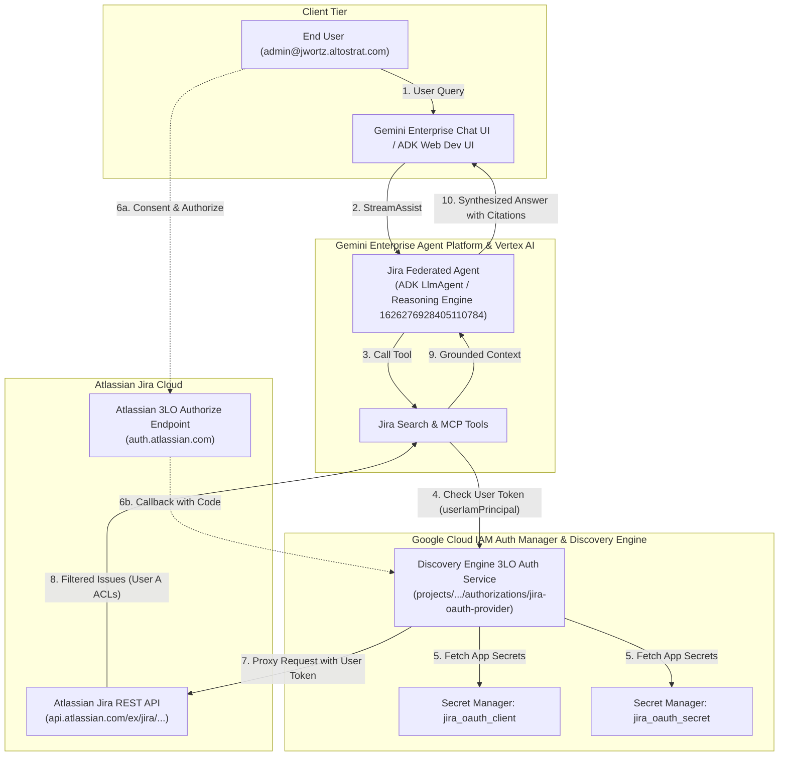
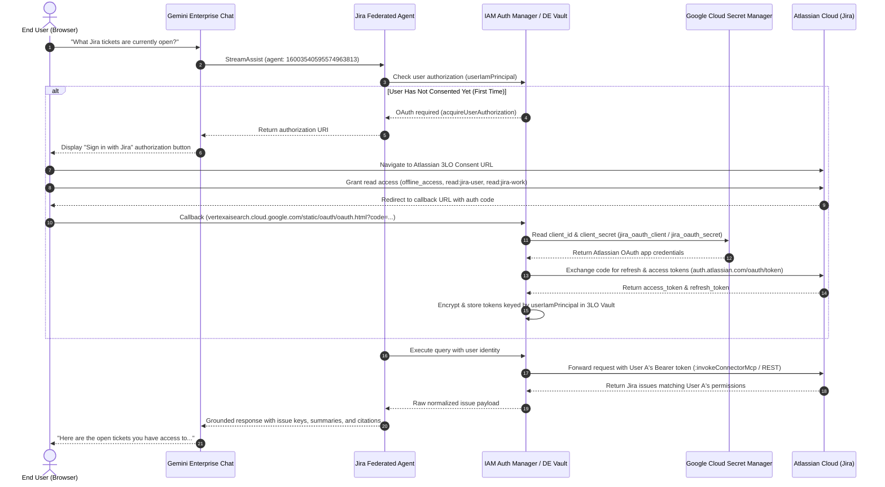

# Implementation Plan & Architecture: `gemini-jira-federated` ADK RAG Agent

## 1. Objective
Build a clean, tested Google ADK repository in `gemini-jira-federated` that demonstrates how to build a grounded RAG agent over the Gemini Enterprise **Federated Jira Data Connector**:
- **Target Engine**: `projects/679926387543/locations/global/collections/default_collection/engines/grocery-workshop-engine`
- **Target Agent ID**: `projects/679926387543/locations/global/collections/default_collection/engines/grocery-workshop-engine/assistants/default_assistant/agents/16003540595574963813`
- **Target Location**: `global` (Discovery Engine) / `us-central1` (Vertex AI Gemini)
- **Delegated Auth Model**: Pattern 2 (Secret Manager + Discovery Engine Authorization Provider + End-User 3LO)

## 2. Technical Architecture & Google Cloud IAM Auth Manager

For detailed Google Cloud conceptual standards on agent authentication brokering, see:
- [Google Cloud IAM Auth Manager Overview](https://docs.cloud.google.com/iam/docs/auth-manager-overview)
- [Agent Identity 3-Legged OAuth with Auth Manager](https://cloud.google.com/iam/docs/agent-identity-auth-manager-oauth3)
- [Manage Agent Identity Auth Providers](https://cloud.google.com/iam/docs/agent-identity-manage-auth-providers)

### System Architecture Diagram



---

### Sequence Flow: End-User 3LO Delegation



---

## 3. Environment & Execution

Activate the local virtual environment:
```bash
source /usr/local/google/home/jwortz/gemini-jira-federated/.venv/bin/activate
```
Or execute commands with `uv run`:
```bash
uv run python scripts/setup_jira_auth_provider.py
uv run pytest -v
```

## 4. Verification & Testing
- Unit tests: `tests/test_config_and_auth.py`, `tests/test_jira_connector_client.py`, `tests/test_setup_jira_auth_provider.py`.
- Live integration tests: `tests/test_integration_live.py`.
- Atlassian 3LO parameter validation: RFC 6749 compliance (`response_type=code`, `redirect_uri`, `prompt=consent`).
