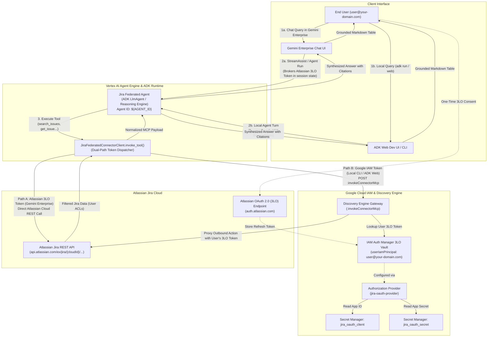
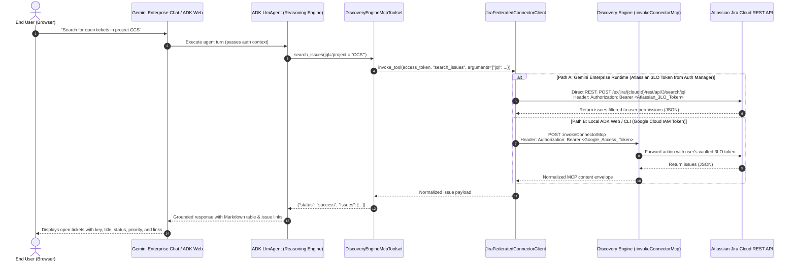
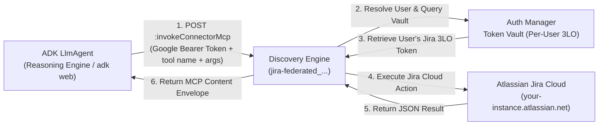

# Implementation Plan & Architecture: `gemini-jira-federated` ADK RAG Agent

## 1. Objective
Build a clean, tested Google ADK repository in `gemini-jira-federated` that demonstrates how to build a grounded RAG agent over the Gemini Enterprise **Federated Jira Data Connector**:
- **Target Engine**: `projects/${PROJECT_NUMBER}/locations/global/collections/default_collection/engines/grocery-workshop-engine`
- **Target Agent ID**: `projects/${PROJECT_NUMBER}/locations/global/collections/default_collection/engines/grocery-workshop-engine/assistants/default_assistant/agents/${AGENT_ID}`
- **Target Location**: `global` (Discovery Engine) / `us-central1` (Vertex AI Gemini)
- **Delegated Auth Model**: Pattern 2 (Secret Manager + Discovery Engine Authorization Provider + End-User 3LO)

## 2. Technical Architecture & Google Cloud IAM Auth Manager

For detailed Google Cloud conceptual standards on agent authentication brokering, see:
- [Google Cloud IAM Auth Manager Overview](https://docs.cloud.google.com/iam/docs/auth-manager-overview)
- [Agent Identity 3-Legged OAuth with Auth Manager](https://cloud.google.com/iam/docs/agent-identity-auth-manager-oauth3)
- [Manage Agent Identity Auth Providers](https://cloud.google.com/iam/docs/agent-identity-manage-auth-providers)

### System Architecture Diagram



---

### Sequence Flow: Dual-Path Jira Invocation (Gemini Enterprise vs. Local ADK)



---

## 3. Gemini Enterprise MCP Connectors & Agent Registry Pattern

Newer Gemini Enterprise DataConnector resources natively serve Model Context Protocol (MCP) interactions through two official, complementary surfaces in Google Cloud:

```mermaid
flowchart TD
    subgraph PatternA["Pattern A: Direct Federated MCP (Current Production Baseline)"]
        AgentA["ADK LlmAgent"]
        ToolsetA["DiscoveryEngineMcpToolset\n(In-Process ADK BaseToolset)"]
        DEA["Discovery Engine Gateway\nPOST :invokeConnectorMcp"]
        VaultA["Auth Manager 3LO Vault\n(userIamPrincipal)"]
        JiraA["Atlassian Jira Cloud"]

        AgentA --> ToolsetA
        ToolsetA -->|"Google Bearer Token\nx-goog-user-project"| DEA
        DEA --> VaultA
        DEA --> JiraA
    end

    subgraph PatternB["Pattern B: Agent Registry & Streamable-HTTP (Next-Gen Fleet Pattern)"]
        AgentB["ADK LlmAgent"]
        RegB["google.adk.integrations.agent_registry.AgentRegistry"]
        McpB["McpToolset (StreamableHTTP)\nPOST/GET/DELETE .../dataConnector/mcp"]
        CredsB["google-adk[agent-identity]\n(GcpAuthProviderScheme)"]
        DEB["DataConnectorMcpService\n(Streamable-HTTP SSE)"]

        AgentB --> RegB
        RegB --> McpB
        McpB <--> CredsB
        McpB -->|"Requires Agent Registry + Agent Gateway / IAP"| DEB
    end
```



### Deployment Status & Architectural Analysis
- **Streamable-HTTP `/dataConnector/mcp`**: **Live in Production on Discovery Engine** (`https://discoveryengine.googleapis.com/v1/projects/{project_number}/locations/{location}/collections/{collection}/dataConnector/mcp`).
- **Google Cloud Agent Registry**: **Live in Production on GCP** (`agentregistry.googleapis.com`). The connector is auto-registered as `projects/${PROJECT_ID}/locations/global/mcpServers/agentregistry-00000000-0000-0000-cdb8-8607e74a4bcf` with `RuntimeReference` linking to `dataConnector` and declaring native tools (`create_issue`, `update_issue`, `create_comment`, etc.).
- **IAP Access & Agent Gateway**: The `/dataConnector/mcp` endpoint validates the `x-goog-iap-egress-jwt-assertion` header injected by Vertex AI Agent Gateway. Raw calls from outside the Agent Gateway perimeter fail with header validation errors.
- **In-Process Toolset vs Stdio Bridge**: The earlier `JIRA_MCP_TRANSPORT=builtin|inprocess` toggle allowed choosing between a FastMCP subprocess bridge and direct in-memory calls. We streamlined to `DiscoveryEngineMcpToolset` 100% in-process, removing subprocess overhead, pipe serialization, and FastMCP deprecation warnings while retaining full 3LO Auth Manager integration.

---

## 4. Required Google Cloud APIs & IAM Roles

### Required Google Cloud APIs
Enable all required APIs with:
```bash
gcloud services enable \
  discoveryengine.googleapis.com \
  aiplatform.googleapis.com \
  secretmanager.googleapis.com \
  iam.googleapis.com \
  iamcredentials.googleapis.com \
  serviceusage.googleapis.com \
  cloudresourcemanager.googleapis.com \
  --project="${PROJECT_ID}"
```

| API Service Name | Service Endpoint | Purpose |
| :--- | :--- | :--- |
| **Discovery Engine API** | `discoveryengine.googleapis.com` | Gemini Enterprise apps, federated Jira connector (`jira-federated_...`), Auth Manager authorizations, and `:invokeConnectorMcp`. |
| **Vertex AI API** | `aiplatform.googleapis.com` | Vertex AI Gemini models, Reasoning Engines, and Agent Engine runtime. |
| **Secret Manager API** | `secretmanager.googleapis.com` | Storage of Atlassian OAuth Client ID and Secret (`jira_oauth_client`, `jira_oauth_secret`). |
| **IAM API & Credentials API** | `iam.googleapis.com`, `iamcredentials.googleapis.com` | Service account token exchange, caller identity validation, and IAM permissions. |
| **Service Usage & Resource Manager** | `serviceusage.googleapis.com`, `cloudresourcemanager.googleapis.com` | Quotas, service enablement, and project-level policy control. |

### Required IAM Roles

| Identity | Role | Purpose |
| :--- | :--- | :--- |
| **Calling User** (`${OAUTH_USER_ACCOUNT}`) | `roles/discoveryengine.admin` | Access Gemini Enterprise search apps and execute data connector actions (`discoveryengine.dataConnectors.executeAction`). |
| | `roles/aiplatform.user` | Query Vertex AI Reasoning Engine agent. |
| | `roles/secretmanager.viewer` | Read secret metadata. |
| **Discovery Engine SA** (`service-${PROJECT_NUMBER}@gcp-sa-discoveryengine.iam.gserviceaccount.com`) | `roles/secretmanager.secretAccessor` | Access `jira_oauth_client` and `jira_oauth_secret` during 3LO exchange. |
| **Reasoning Engine / Compute SA** (`${PROJECT_NUMBER}-compute@developer.gserviceaccount.com`) | `roles/discoveryengine.admin` | Execute `:invokeConnectorMcp` against the federated collection. |
| | `roles/secretmanager.secretAccessor` | Read app credentials if executing headless scripts. |

---

## 4. Environment & Execution

Activate the local virtual environment:
```bash
source .venv/bin/activate
```
Or execute commands with `uv run`:
```bash
uv run python scripts/setup_jira_auth_provider.py
uv run pytest -v
```

## 5. Option A: Direct Federated MCP Tool (`dataConnector:invokeConnectorMcp`)

### Architecture: Zero Direct Atlassian Credentials in Agent
Instead of the agent holding or negotiating Jira credentials directly, the Discovery Engine Federated Connector natively exposes Model Context Protocol (MCP) tool endpoints. The agent executes tools via the unified Google Cloud Discovery Engine RPC:

```
POST https://discoveryengine.googleapis.com/v1alpha/projects/{project}/locations/{location}/collections/{collection}/dataConnector:invokeConnectorMcp
```



### Supported MCP Actions in `jira-federated_1782320633397`
The federated connector provides 32 built-in MCP tools, including:
- **`search_issues`**: Searches issues using bounded or unbounded JQL queries (`{"query": "...", "maxResults": 20}`).
- **`get_issue`**: Retrieves full issue fields, status, priority, and attachments (`{"Id": "GEAP-3"}`).
- **`list_projects` / `search_projects`**: Lists or searches Jira projects accessible to the user.
- **`create_comment`**: Posts an update or comment to a ticket (`{"IssueKey": "...", "Body": "..."}`).
- **`update_comment`**: Updates an existing comment (`{"IssueKey": "...", "Id": ..., "Body": "..."}`).
- **`list_comments`**: Lists all comments on a ticket (`{"IssueKey": "..."}`).
- **`create_issue`**: Creates a new ticket (`{"ProjectKey": "...", "Summary": "...", "IssueTypeId": "10001", "Description": "..."}`).
- **`upload_attachment`**: Attaches a file to a ticket (`{"IssueKey": "...", "InputFileName": "..."}`).
- **`list_tools`**: Catalog inspection via `method: "tools/list"`.

---

## 6. Verification & Testing
- Unit tests: `tests/test_config_and_auth.py`, `tests/test_jira_connector_client.py`, `tests/test_setup_jira_auth_provider.py`.
- Live integration tests: `tests/test_integration_live.py`.
- Atlassian 3LO parameter validation: RFC 6749 compliance (`response_type=code`, `redirect_uri`, `prompt=consent`).
