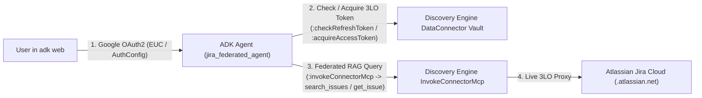

# Implementation Plan: `gemini-jira-federated` ADK RAG Agent

## 1. Objective
Build a clean, tested Google ADK repository in `gemini-jira-federated` that demonstrates how to build a grounded RAG agent over the Gemini Enterprise **Federated Jira Data Connector**:
- **Configuration**: Managed dynamically via `.env` (`DISCOVERY_ENGINE_PROJECT_ID`, `DISCOVERY_ENGINE_ID`, `JIRA_CONNECTOR_COLLECTION_ID`, `JIRA_INSTANCE_URI`, `OAUTH_USER_ACCOUNT`).
- **Target Location**: `global` (Discovery Engine) / `us-central1` (Vertex AI Gemini)

## 2. Technical Architecture
Because the unified connector is a Federated Connector (`connectorType: "THIRD_PARTY_FEDERATED"`, `connectorModes: ["FEDERATED", "ACTIONS"]`, `incrementalSyncDisabled: true`), zero documents are stored in Branch 0. Instead, Discovery Engine proxies queries at runtime using the end-user's OAuth identity:

### Repository Structure
- `pyproject.toml` — `uv` project configuration and dependencies (`google-adk`, `google-auth`, `google-genai`, `requests`, `python-dotenv`, `pytest`).
- `.gitignore` / `.env.example` — Non-secret configuration template.
- `jira_federated_agent/`
  - `__init__.py` — Exposes `agent` module for `adk web`.
  - `config.py` — Typed configuration loader and input validators.
  - `auth.py` — End-user OAuth2 credential resolver (supports ADK `AuthConfig` / `tool_context.request_credential` in `adk web`, environment OAuth tokens, and local Google OAuth user credentials, plus Vertex AI ADC bridging).
  - `jira_connector_client.py` — Client for Discovery Engine `DataConnectorService` (`:checkRefreshToken`, `:acquireAccessToken`, `:acquireAndStoreRefreshToken`, `widgetConfigs/default_search_widget_config`, and `:invokeConnectorMcp` for `search_issues`, `get_issue`, `list_projects`, and `search_projects`).
  - `agent.py` — Defines the ADK `root_agent` (`LlmAgent`) and tool functions with OAuth verification and grounded Jira citations.
- `tests/`
  - `test_config_and_auth.py` — Unit tests for input validation, JQL sanitization, OAuth credential resolution, and ADK `AuthConfig` generation.
  - `test_jira_connector_client.py` — Unit tests for Discovery Engine federated connector calls (`check_oauth_status`, `search_issues`, `get_issue`, `list_projects`, `complete_oauth_consent`).
  - `test_integration_live.py` — Live integration test against the configured connector verifying real Jira issues are retrieved when credentials are available.

## Verification Plan

### Unit & Live Integration Testing (TDD)
1. Write unit tests in `tests/` first covering JQL builder/validation, OAuth token resolution, and Discovery Engine `:invokeConnectorMcp` response parsing.
2. Implement `jira_federated_agent` modules and run `uv run pytest` until 100% of unit and live integration tests pass.
3. Launch `uv run adk web --host 127.0.0.1 --port 8000` and verify via the `adk web` API/UI that the user can authenticate and retrieve live Jira issues.

### Automated Security Check
- **Security Scanner**: Run a scan on all newly created files to identify common vulnerabilities (e.g., XSS, SQL/JQL injection, hardcoded secrets). If findings are detected, auto-apply the fix and document the results.
- **Security Audit**: Audit the new code for design-level security issues:
  - Input validation & JQL escaping on all user-supplied search queries, project keys, and issue keys.
  - No hardcoded secrets, OAuth client secrets, or tokens in source code or logs.
  - `adk web` server strictly bound to `127.0.0.1` (never `0.0.0.0`).
  - All outbound API communication over HTTPS (`https://discoveryengine.googleapis.com` and `https://oauth2.googleapis.com`).
